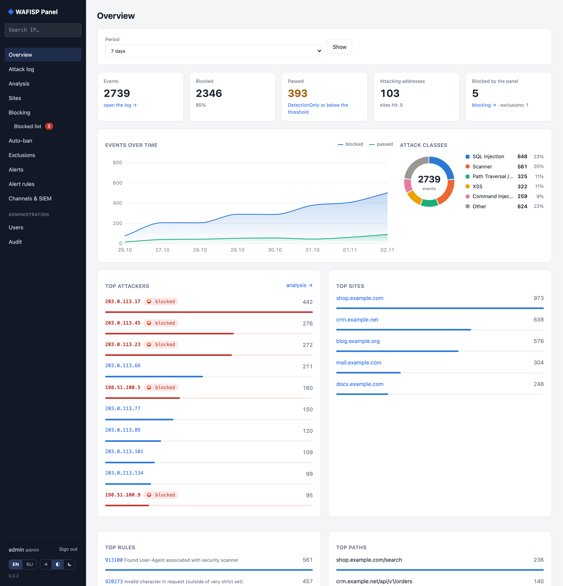
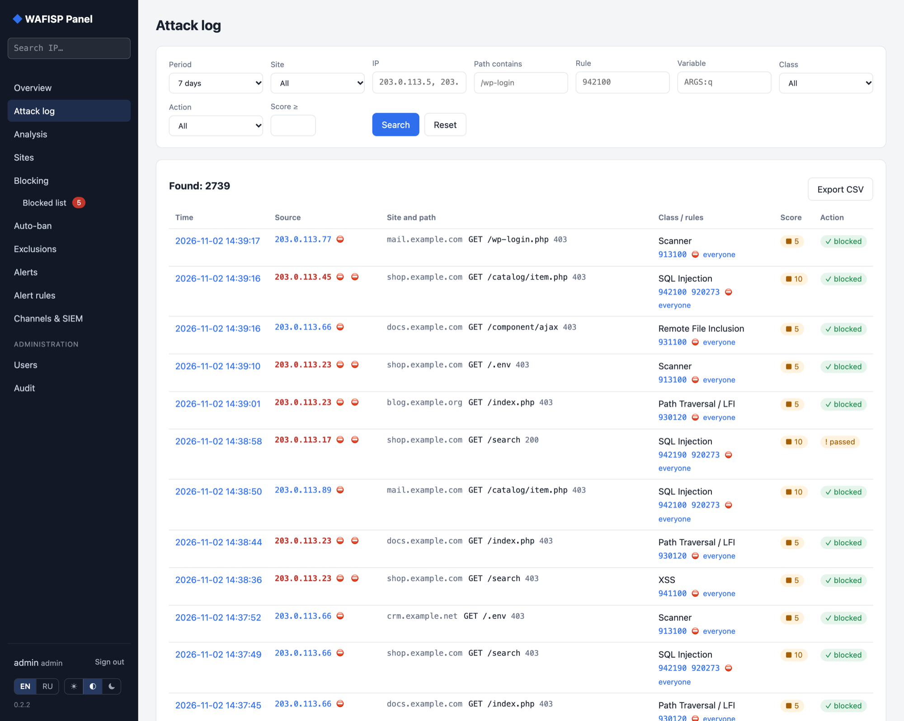
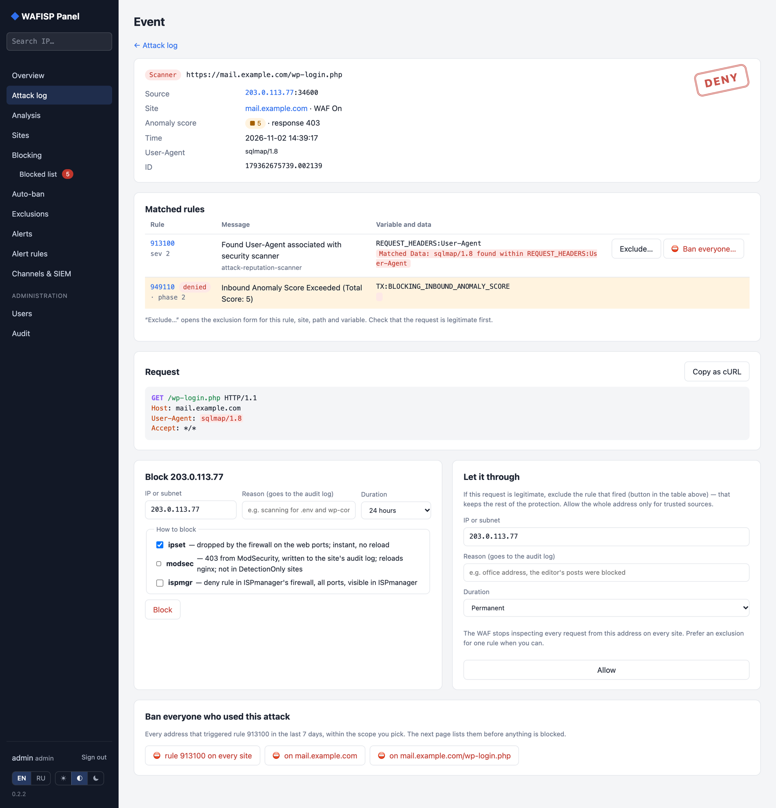
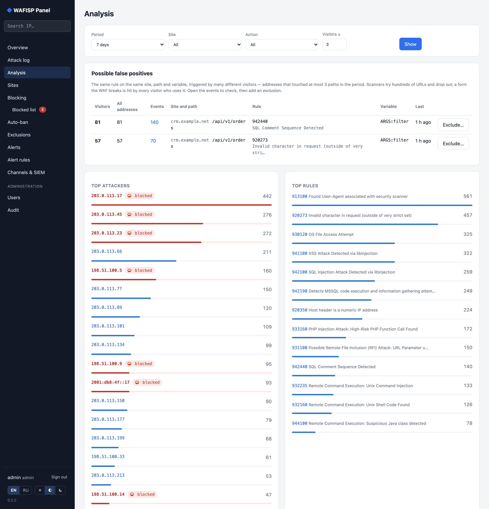
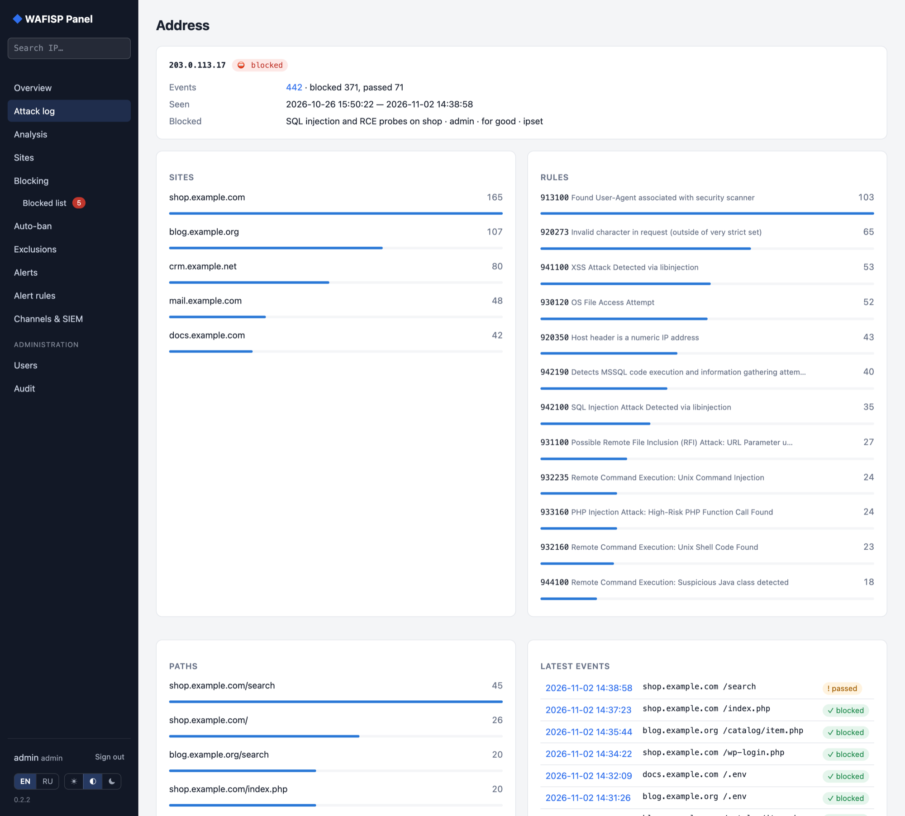
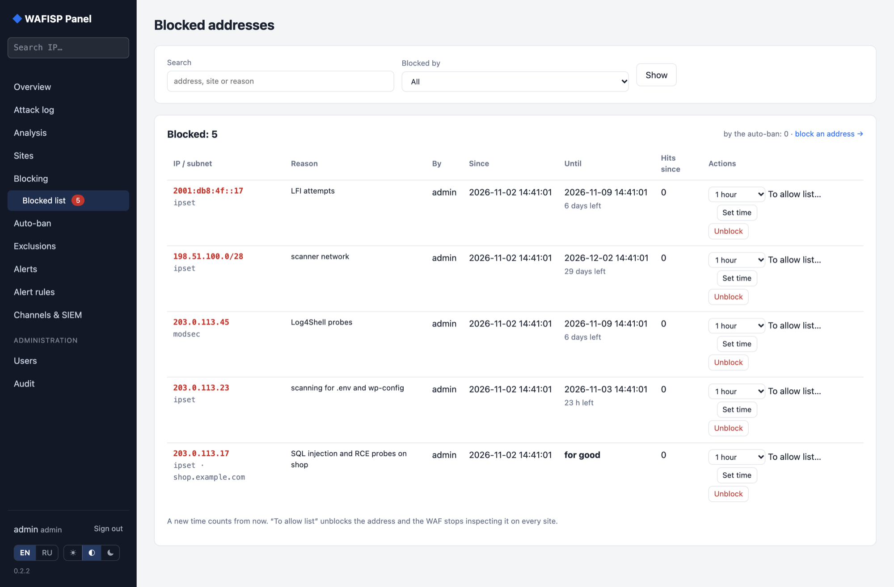
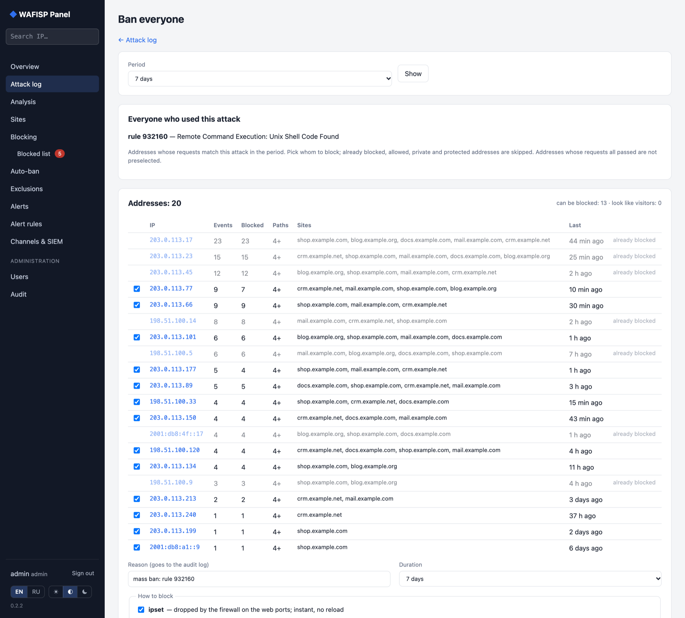
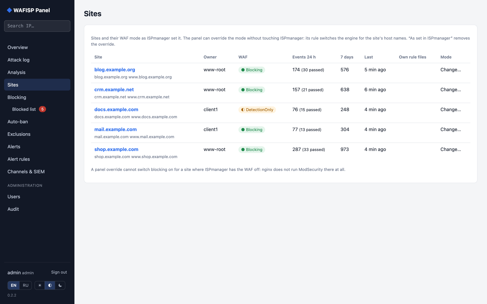
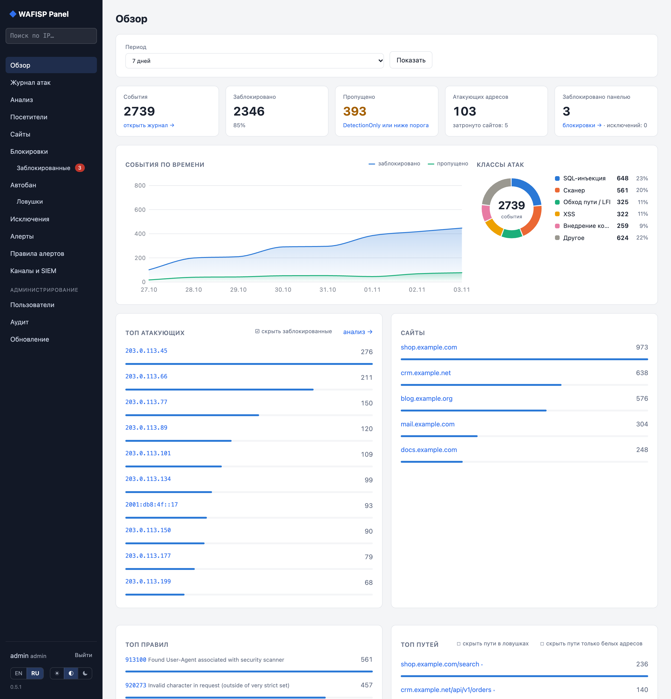

# WAFISP Panel

A panel for the WAF of an [ISPmanager](https://www.ispmanager.com/) host.

ISPmanager's "WAF module for Nginx" is ModSecurity v3 with the OWASP Core Rule Set inside nginx (Apache, if any, is only the backend). ISPmanager turns it on per site and writes one audit log per site, but gives no overview, no search, no blocking and only a crude per-site rule list. WAFISP Panel is a single Go binary on the same host that reads those audit logs and fills the gap.



## Screenshots

The screenshots show made-up demo data: documentation addresses and `example.*` sites.

| | |
|---|---|
| [](docs/screenshots/attacks.png)<br>**Attack log** with filters; blocked addresses in red | [](docs/screenshots/event.png)<br>**Event card**: matched rules, request, block / allow / ban everyone |
| [](docs/screenshots/analysis.png)<br>**Analysis**: possible false positives, top attackers and rules | [](docs/screenshots/ip.png)<br>**Address page**: what one address did and whether it is blocked |
| [](docs/screenshots/blocked.png)<br>**Blocked list**: change the term, unblock, move to the allow list | [](docs/screenshots/massban.png)<br>**Ban everyone** who used one attack, after a review |
| [](docs/screenshots/sites.png)<br>**Sites** with their WAF mode and per-site override | [](docs/screenshots/ru/overview.png)<br>**Russian UI** ([all pages](docs/screenshots/ru)) |

## Features

**See what happens**

- **Overview**: events over time, attack classes, top attackers, sites, rules, paths and countries, and the health of every audit log. Addresses that are already blocked are shown in red.
- **Attack log** with filters: period, site, address or subnet (`203.0.113.0/24`, `203.0.113.*`), path, rule, matched variable, class, action, client (browser, bot, script or scanner, read from the User-Agent) and anomaly score. CSV export.
- **Event card**: the request, every matched rule with its variable and data, and "copy as cURL".
- **Address search** from the menu. It shows everything known about one address: its events, sites, classes and whether it is blocked or allowed.
- **Visitors**: all traffic from the nginx access logs, not only attacks: requests and page views over time, devices (desktop, phone, tablet), operating systems and browsers, bots and scripts, response codes, top pages and 404s, and where visitors come from (search engines such as Google, Yandex, Bing/MSN and Mail.ru, social networks, other sites, direct). Only hourly counts are kept, for a year, so ISPmanager can rotate and delete the logs.
- **Analysis**: possible false positives (the same rule on the same site, path and variable hit by many ordinary visitors rather than scanners), plus top attackers, rules, paths and countries.

**Block and unblock**

- **Blocking** of addresses and subnets for a set time or for good, through any of three backends:
  - `ipset`: the panel's own set, dropped by one iptables rule on the web ports. Instant, no nginx reload.
  - `modsec`: a deny list in the panel's ModSecurity rules. Requests get 403 and land in the site's audit log.
  - `ispmgr`: a deny rule in ISPmanager's firewall, added through `mgrctl`, so it is visible in ISPmanager.
- **Blocked list**: every blocked address with its backends, reason and expiry. Every blocked address shows in red, and its address and event pages say who blocked it (by hand, mass ban, auto-ban or a trap), when and why; an automatic ban names the exact rule that fired. From there you can change the term, unblock, or move the address to the allow list.
- **One-click ban**: "for a day" / "for good" next to every address in the log and the top attackers.
- **Ban by attack**: from an event, block every address that triggered the same rule, class or path in the chosen period. You see the list first and confirm it. The panel warns you when the list looks like ordinary visitors rather than attackers.
- **Traps**: click a path in the top paths to see its events, ban everyone who requested it, or set a trap that bans whoever requests it from now on, for a set time or for good. A trap matches the start of the path or any part of it: one `.env` trap covers every site. Default traps for `/.env`, `/.git/`, `/.aws/`, `/phpinfo.php`, `/.zshrc` and `/.bashrc` come in dry run. The top lists can hide blocked addresses and trapped paths; the choice is remembered in the browser. Where nginx loads the panel's rules, every request to a trap path gets 403 and lands in the audit log, so even a plain visit is caught.
- **Auto-ban** of addresses that keep attacking. It triggers on N denied requests within a window, or on one denied request of a dangerous class (RCE, web shell, Java by default). A repeat offender is blocked for longer each time: a day, then a week, then for good. Auto-ban starts off and in dry-run mode, where it only records whom it would block.
- **Protected addresses**: private networks, the panel's own addresses, your own address, Cloudflare's networks and a configured list can never be blocked. For a site behind Cloudflare the WAF sees Cloudflare's servers, not the visitors, so banning one would cut off everyone coming through it; such addresses are marked "☁ Cloudflare".
- **Sites**: every site with its WAF mode and what it means — blocking, logging only, or no WAF at all — with the unprotected ones highlighted and listed first, and their traffic.

**Tune the WAF**

- **Allow list**: trusted addresses are never blocked or banned. The WAF still logs their requests, marked as passed. Adding an address lifts its blocks, and the panel refuses to block it until it is taken off the list.
- **Exclusions** that switch CRS rules off where they break legitimate requests, scoped to a site, a path prefix and one request variable.
- **Site modes**: switch a site to DetectionOnly or turn it off, without touching ISPmanager.
- Every rule change goes through `nginx -t` first and is rolled back if nginx refuses it.

**Operate**

- **Alerts** to Telegram, email and webhooks, driven by rules: thresholds per window, grouping and cooldown.
- **SIEM forwarding** of every event over syslog (UDP/TCP/TLS) as CEF or JSON.
- **Access by source**: `web.allow_from` lets in only the listed addresses and networks.
- **Users and audit**: `admin` and `viewer` roles, bcrypt, login throttling, CSRF protection, and an audit log of every action.
- **Updates from GitHub**: the panel checks for a new release every few hours and shows what is new. An admin installs it with one click. The panel installs only releases signed with the project's key, checks the new version against the current config first, keeps the old binary, and puts it back if the new one does not come up. A rollback button is there too.
- **English and Russian** UI.
- `/healthz` and Prometheus `/metrics` on a separate local port.

## Safe for ISPmanager

ISPmanager rewrites its own files on updates and when a site changes, so the panel never edits them: no vhosts, no `vhosts-resources`, no `/etc/modsecurity`, no templates.

- The panel's rules live in a directory of their own, `/etc/wafisp/modsec`. nginx loads them around the CRS rules through one include, which you add by hand once (see [Deployment](docs/DEPLOYMENT.md)).
- ISPmanager's firewall is changed only through `mgrctl`.
- Every five minutes the panel checks that nginx still loads its rules. If an update removed the include, it warns on every page and in `system_channels`. It never repairs nginx's config by itself.

## Quick start

Requirements:

- Go 1.27+ to build.
- An ISPmanager host with the nginx WAF module (ModSecurity v3, CRS 4) and audit logs in Serial format.
- Root on the host: the panel manages ipset/iptables and calls `mgrctl`.

```bash
make test
make linux                        # bin/wafisp-linux-amd64
cp deploy/wafisp.example.yaml wafisp.yaml
```

Or take `wafisp-linux-amd64` from the latest [release](https://github.com/BorisGB2001/WAFISP-Panel/releases) and put it in `bin/`; its `.sha256` file holds the checksum.

Edit `wafisp.yaml`. At a minimum, set `web.listen` to internal addresses only (office network, VPN) and set `block.protected`. Then copy the project to the host and run, as root:

```bash
sh deploy/install.sh wafisp.yaml secrets
```

The installer installs the binary, the config and the systemd unit. It runs `-check` against the new config before switching over. It does not touch nginx.

The first password of `admin` is in `/var/lib/wafisp/initial-admin-password`. Change it after the first sign-in.

Open `https://<internal address>:12443`.

Roll it out in two steps:

1. Read-only: the panel only reads the logs.
2. Add the nginx include, which turns on exclusions, site modes and the `modsec` backend.

Both steps are described in [Deployment](docs/DEPLOYMENT.md), along with how to undo everything.

## Command line

| Flag | Purpose |
|---|---|
| `-config path` | config file, `/etc/wafisp/wafisp.yaml` by default |
| `-check` | validate the config, parse every audit log, list the sites, and say whether nginx loads the panel's rules; changes nothing |
| `-parse file` | parse one audit log and print a summary |
| `-test-channel name` | send a test alert to one channel and exit |
| `-dry-run` | log alerts instead of sending them, send nothing to SIEM, run no expiry jobs |
| `-reset-password user` | set a random password and print it |
| `-version` | print the version |

## Documentation

- [Architecture](docs/ARCHITECTURE.md): how the panel reads, stores, blocks and applies rules
- [Deployment](docs/DEPLOYMENT.md): install, the nginx include, safety, undo, data on disk

## Status

Version 0.2.2. Built and run against ISPmanager 6, libmodsecurity 3.0.14 and OWASP CRS 4.
