# WAFISP Panel

[English](README.md) · **Русский**

Панель для WAF на хостинге с [ISPmanager](https://www.ispmanager.com/ru).

«WAF-модуль для Nginx» в ISPmanager — это ModSecurity v3 с OWASP Core Rule Set внутри nginx (Apache, если он есть, работает только бэкендом). ISPmanager включает его для каждого сайта отдельно и пишет по журналу аудита на сайт. Обзора, поиска и блокировок там нет, а список правил на сайт очень примитивный. WAFISP Panel — один бинарный файл на Go, который ставится на тот же сервер, читает эти журналы и закрывает эти пробелы.

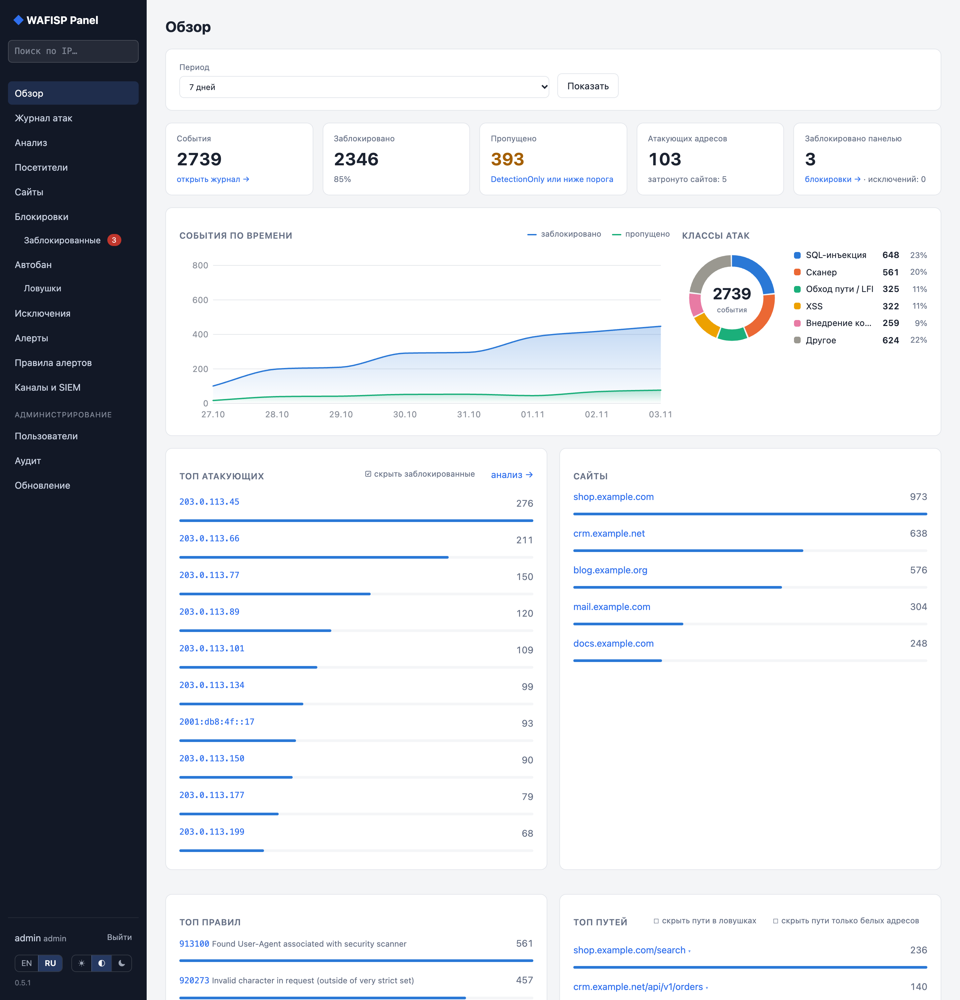

## Скриншоты

На скриншотах выдуманные демо-данные: адреса из диапазонов для документации и сайты `example.*`.

| | |
|---|---|
| [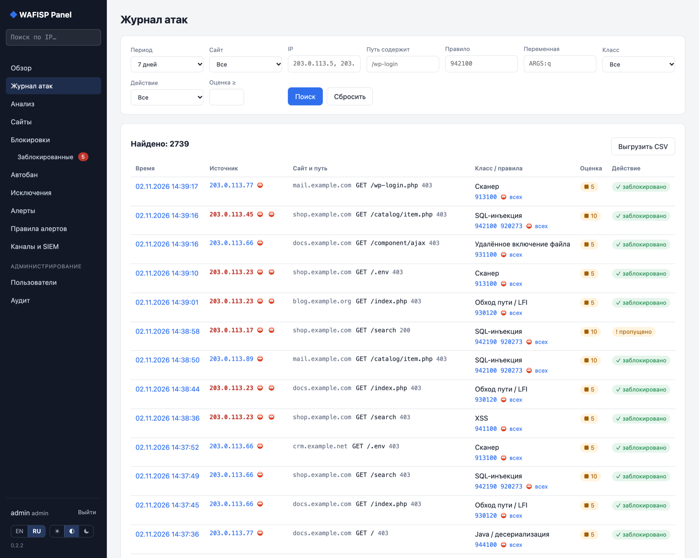](docs/screenshots/ru/attacks.png)<br>**Журнал атак** с фильтрами; заблокированные адреса красные | [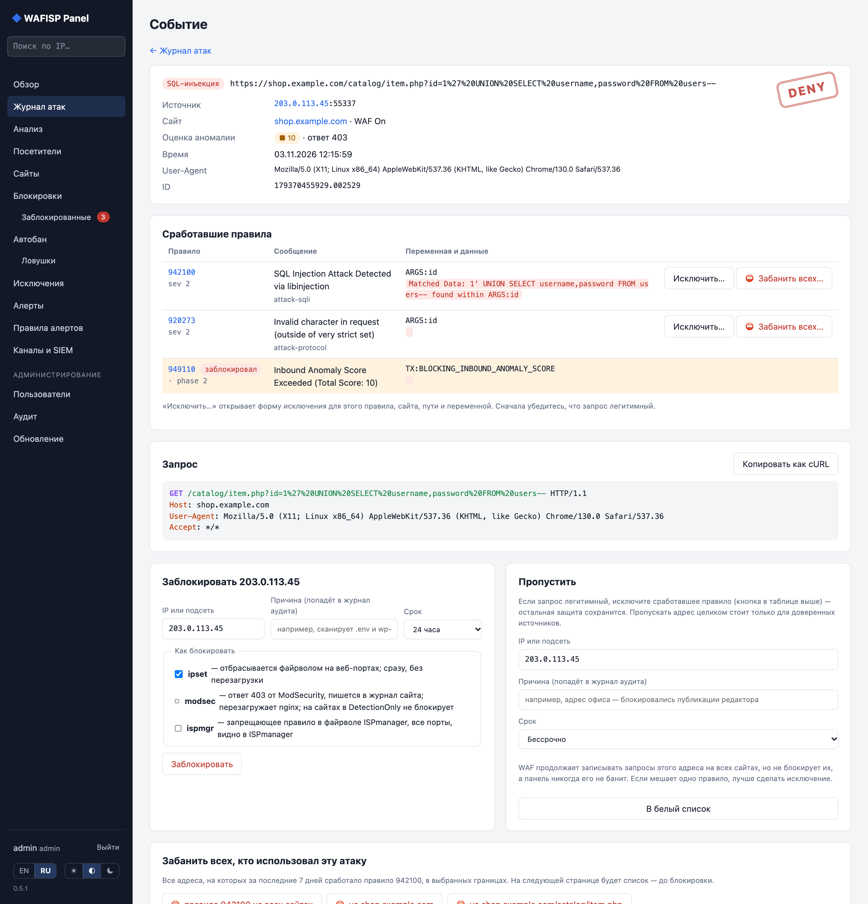](docs/screenshots/ru/event.png)<br>**Карточка события**: сработавшие правила, запрос, заблокировать / пропустить / забанить всех |
| [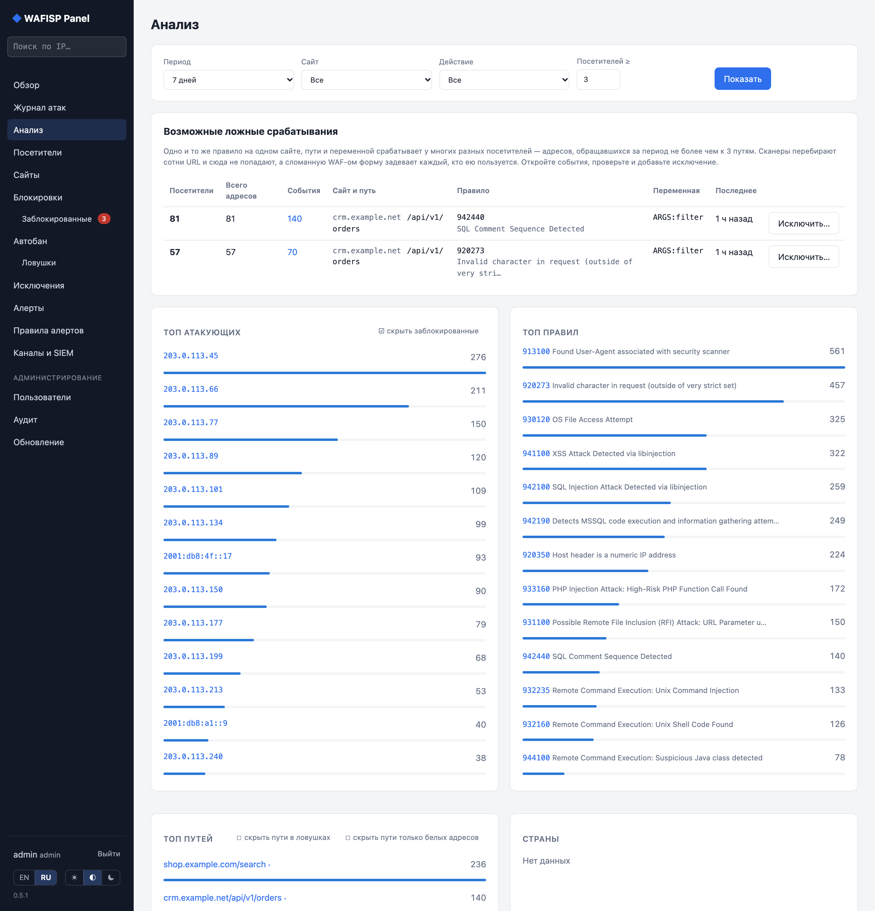](docs/screenshots/ru/analysis.png)<br>**Анализ**: возможные ложные срабатывания, топ атакующих и правил | [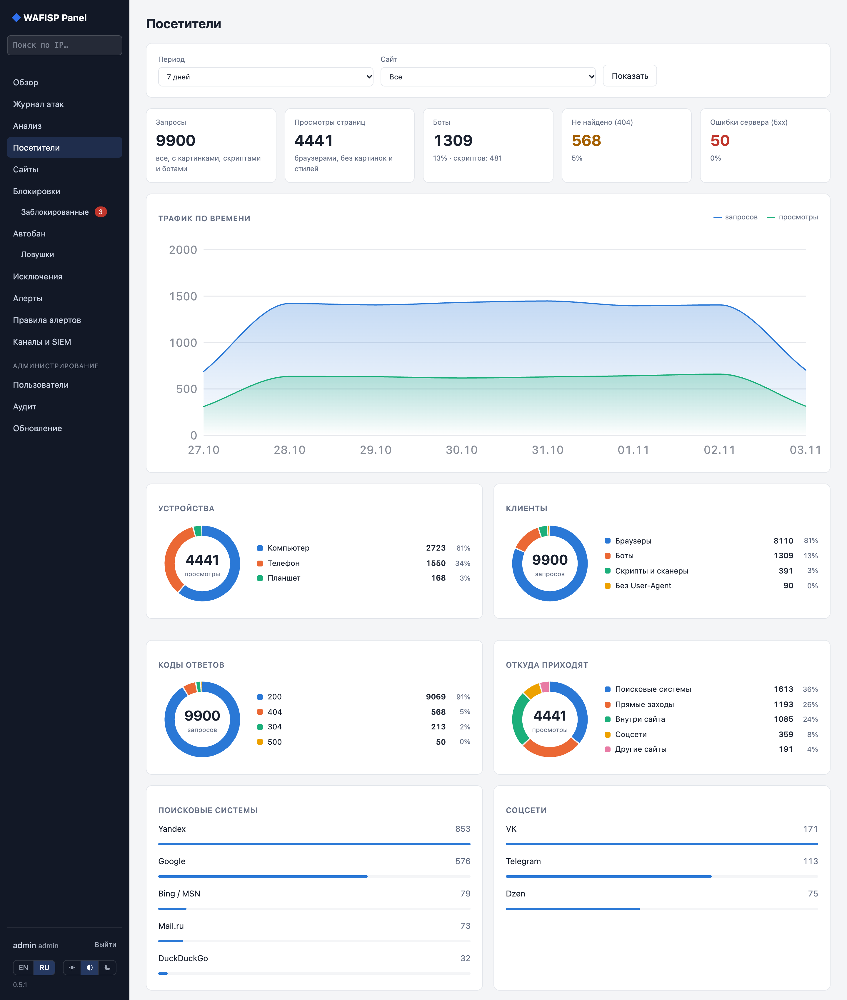](docs/screenshots/ru/visitors.png)<br>**Посетители**: весь трафик из access-логов — устройства, клиенты, коды ответов, источники |
| [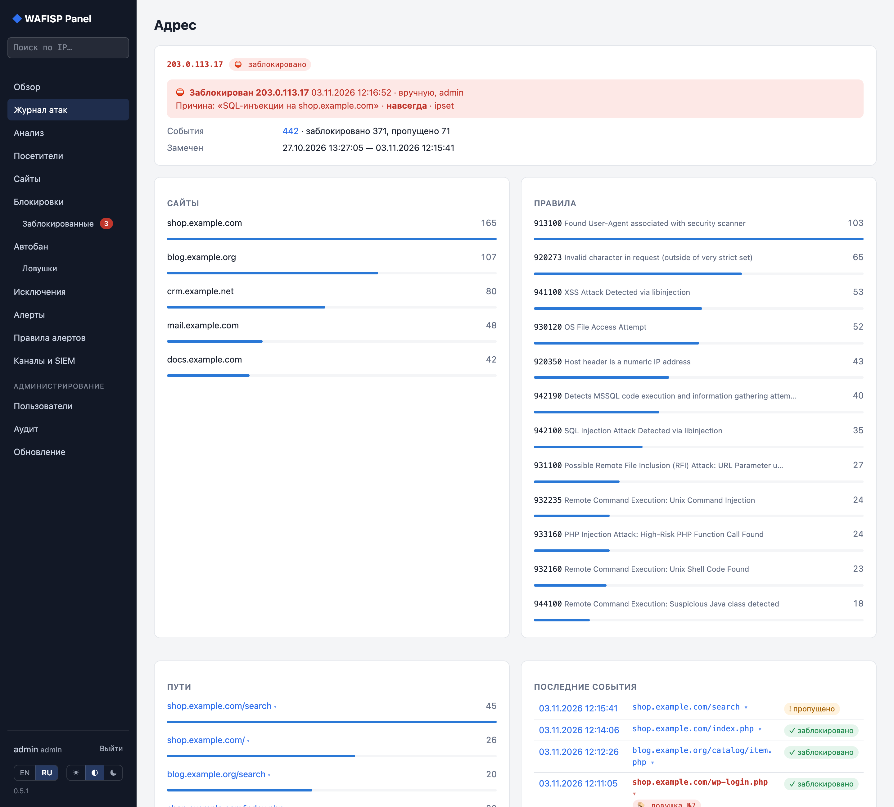](docs/screenshots/ru/ip.png)<br>**Страница адреса**: что делал адрес и заблокирован ли он | [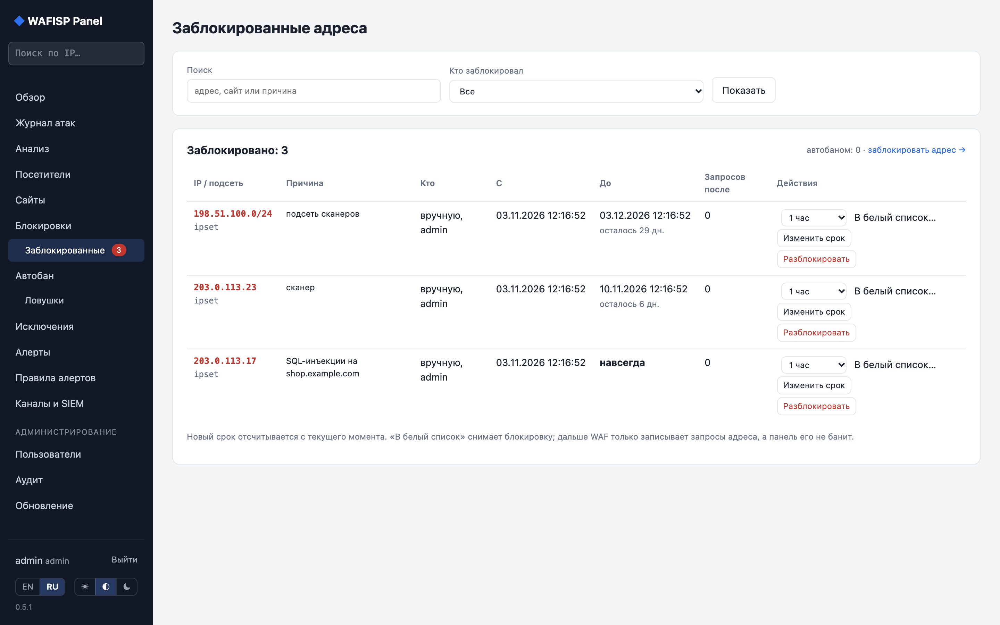](docs/screenshots/ru/blocked.png)<br>**Заблокированные**: сменить срок, разблокировать, перенести в белый список |
| [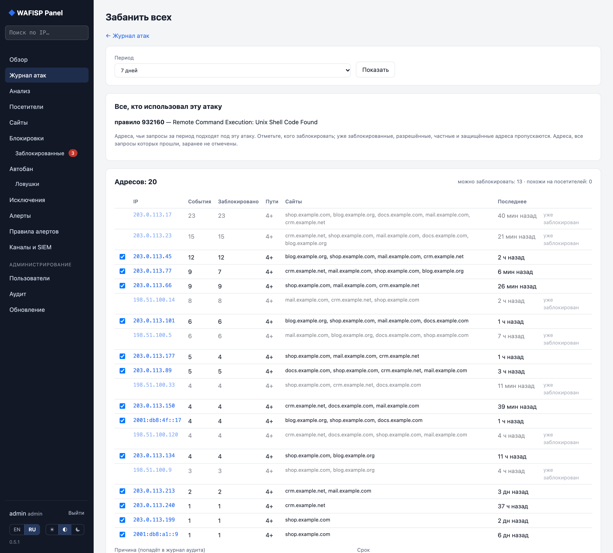](docs/screenshots/ru/massban.png)<br>**Забанить всех**, кто использовал одну атаку, после проверки списка | [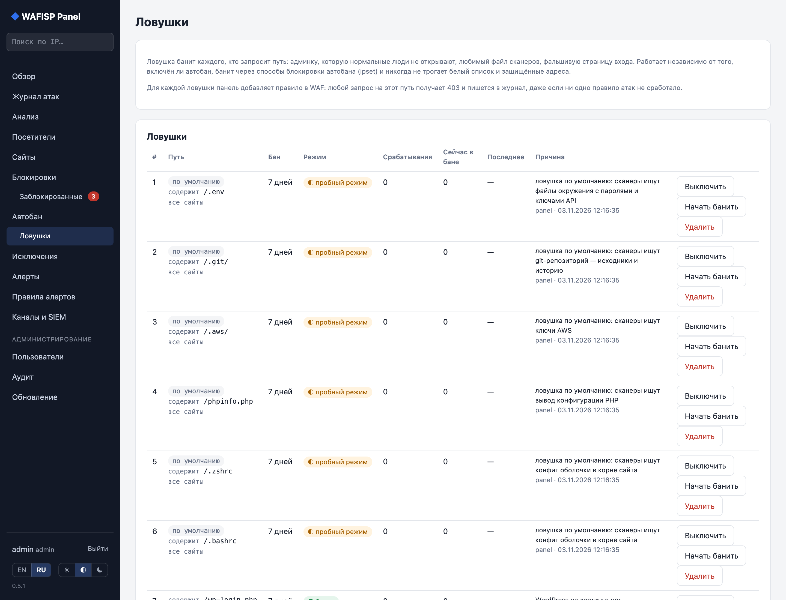](docs/screenshots/ru/traps.png)<br>**Ловушки**: бан за запрос пути; ловушки по умолчанию начинают в пробном режиме |
| [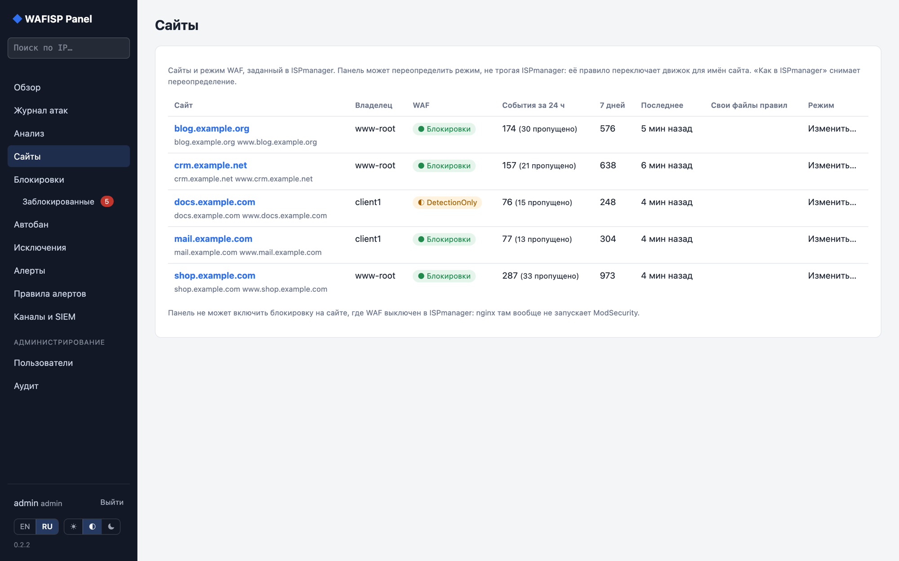](docs/screenshots/ru/sites.png)<br>**Сайты**: режим WAF, защита, трафик; сайты без защиты подсвечены | [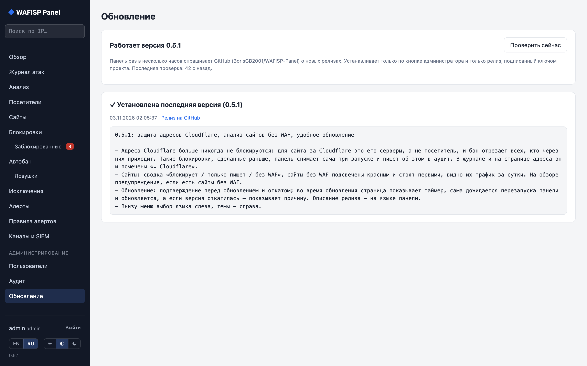](docs/screenshots/ru/update.png)<br>**Обновление** с GitHub по кнопке, с подписью и автооткатом |

## Возможности

**Видеть, что происходит**

- **Обзор**: события по времени, классы атак, топ атакующих, сайтов, правил, путей и стран, состояние каждого журнала аудита. Уже заблокированные адреса выделены красным.
- **Журнал атак** с фильтрами: период, сайт, адрес или подсеть (`203.0.113.0/24`, `203.0.113.*`), путь, правило, переменная, класс, действие, клиент (браузер, бот, скрипт или сканер — по User-Agent) и оценка аномалии. Выгрузка в CSV.
- **Карточка события**: запрос, каждое сработавшее правило с переменной и данными, «Копировать как cURL».
- **Поиск по адресу** из меню: всё, что известно об адресе — события, сайты, классы атак, заблокирован он или в белом списке.
- **Посетители**: весь трафик из access-логов nginx, а не только атаки. Запросы и просмотры по времени, устройства (компьютер, телефон, планшет), ОС и браузеры, боты и скрипты, коды ответов, топ страниц и 404, откуда приходят посетители: поисковики (Google, Яндекс, Bing/MSN, Mail.ru), соцсети, другие сайты, прямые заходы. Хранятся только почасовые счётчики, год, поэтому ISPmanager может спокойно ротировать и удалять логи. Там же видно, у каких сайтов в ISPmanager выключен журнал запросов, и админ может включить его одному сайту или всем сразу (через `mgrctl`, конфиг переписывает сам ISPmanager).
- **Анализ**: возможные ложные срабатывания (одно и то же правило на одном сайте, пути и переменной у многих обычных посетителей, а не у сканеров), а также топ атакующих, правил, путей и стран.

**Блокировать и разблокировать**

- **Блокировка** адресов и подсетей на время или навсегда, через любой из трёх способов:
  - `ipset`: свой набор панели, который отбрасывается одним правилом iptables на веб-портах. Сразу, без перезагрузки nginx.
  - `modsec`: список запрета в правилах ModSecurity панели. Запросы получают 403 и попадают в журнал аудита сайта.
  - `ispmgr`: запрещающее правило в файрволе ISPmanager через `mgrctl`, видно в самом ISPmanager.
- **Заблокированные**: каждый адрес со способом, причиной и сроком. Заблокированные адреса везде красные, а на страницах адреса и события написано, кто заблокировал (вручную, массовый бан, автобан или ловушка), когда и почему; для автобана указано конкретное правило. Отсюда можно сменить срок, разблокировать или перенести в белый список.
- **Бан в один клик**: «на сутки» / «навсегда» рядом с каждым адресом в журнале и в топе атакующих.
- **Бан по атаке**: из события можно заблокировать всех, кто вызвал то же правило, класс или путь за выбранный период. Сначала панель показывает список, потом вы подтверждаете. Если список похож на обычных посетителей, а не на атакующих, панель предупредит.
- **Ловушки**: нажмите на путь в топе путей — увидите его события, сможете забанить всех, кто его запрашивал, или поставить ловушку, которая будет банить каждого следующего, на время или навсегда. Ловушка срабатывает на начало пути или на любую его часть: одна ловушка `.env` покрывает все сайты. Ловушки по умолчанию для `/.env`, `/.git/`, `/.aws/`, `/phpinfo.php`, `/.zshrc` и `/.bashrc` ставятся в пробном режиме. Топы умеют скрывать заблокированные адреса и пути в ловушках; выбор запоминается в браузере. Если nginx подключает правила панели, любой запрос к пути-ловушке получает 403 и попадает в журнал, так что ловится даже простой заход.
- **Автобан** адресов, которые продолжают атаковать: N отклонённых запросов за окно или один запрос опасного класса (по умолчанию RCE, веб-шелл, Java). Повторных нарушителей блокирует всё дольше: сутки, неделя, навсегда. Изначально автобан выключен и работает в пробном режиме — только записывает, кого заблокировал бы.
- **Автобан по access-логам** ловит то, чего WAF не видит: адрес, который запрашивает много несуществующих страниц (404), раз за разом отправляет формы входа (`/wp-login.php`, `/xmlrpc.php`, `/bitrix/admin/` и другие) или шлёт поток запросов. Отсутствующие картинки и стили не считаются, боты поисковиков не банятся никогда. Включается и проверяется в пробном режиме отдельно от правил WAF.
- **Общий бан-лист** для нескольких серверов: адрес, забаненный на одном сервере — вручную, автобаном или ловушкой, — в течение минуты блокируется на остальных и разблокируется вместе с ним. Каждая панель публикует в приватный репозиторий GitHub только свои блокировки, подписанные своим ключом, и применяет списки серверов, которым доверяет. Защищённые адреса, Cloudflare и белый список каждого сервера не затрагиваются, а блокировка, снятая на сервере вручную, остаётся снятой. Начинает в пробном режиме.
- **Защищённые адреса**: частные сети, адреса самой панели, ваш собственный адрес, сети Cloudflare и заданный список заблокировать нельзя. Для сайта за Cloudflare WAF видит серверы Cloudflare, а не посетителей, и бан такого адреса отрезал бы всех, кто через него приходит; такие адреса помечены «☁ Cloudflare».
- **Сайты**: каждый сайт с режимом WAF и тем, что он значит — блокирует, только записывает или WAF нет вообще. Незащищённые сайты подсвечены и стоят первыми, рядом их трафик.

**Настраивать WAF**

- **Белый список**: доверенные адреса никогда не блокируются и не банятся. WAF по-прежнему записывает их запросы с пометкой «пропущено». Добавление адреса снимает его блокировки, и панель не даст заблокировать его, пока он в списке.
- **Исключения** отключают правила CRS там, где они ломают нормальные запросы: для сайта, префикса пути и одной переменной запроса.
- **Режим сайта**: перевести сайт в DetectionOnly или выключить WAF, не трогая ISPmanager.
- Каждое изменение правил сначала проходит `nginx -t` и откатывается, если nginx его не принял.

**Эксплуатация**

- **Алерты** в Telegram, на почту и в вебхуки по правилам: пороги за окно, группировка, пауза между повторами.
- **Отправка в SIEM** каждого события по syslog (UDP/TCP/TLS) в формате CEF или JSON.
- **Доступ по адресу**: `web.allow_from` пускает только перечисленные адреса и сети.
- **Пользователи и аудит**: роли `admin` и `viewer`, bcrypt, ограничение попыток входа, защита от CSRF и журнал всех действий.
- **Обновления с GitHub**: раз в несколько часов панель проверяет новый релиз и показывает, что в нём нового, на языке панели. Администратор ставит его одной кнопкой с подтверждением. Панель ставит только релизы, подписанные ключом проекта, заранее проверяет новую версию на текущем конфиге, сохраняет старый бинарник и возвращает его, если новая версия не поднялась. Во время обновления страница показывает таймер и сама перезагружается. Есть и кнопка отката.
- **Интерфейс на русском и английском**.
- `/healthz` и Prometheus `/metrics` на отдельном локальном порту.

## Безопасно для ISPmanager

ISPmanager перезаписывает свои файлы при обновлениях и при изменении сайта, поэтому панель их никогда не правит: ни vhosts, ни `vhosts-resources`, ни `/etc/modsecurity`, ни шаблоны.

- Правила панели лежат в своём каталоге `/etc/wafisp/modsec`. nginx подключает их вокруг правил CRS одним include, который вы добавляете руками один раз (см. [развёртывание](docs/DEPLOYMENT.md)).
- Файрвол ISPmanager меняется только через `mgrctl`.
- Каждые пять минут панель проверяет, что nginx всё ещё подключает её правила. Если обновление убрало include, панель предупреждает на каждой странице и в `system_channels`. Сама конфигурацию nginx она никогда не чинит.

## Быстрый старт

Что нужно:

- Go 1.27+ для сборки.
- Сервер с ISPmanager и WAF-модулем nginx (ModSecurity v3, CRS 4), журналы аудита в формате Serial.
- root на сервере: панель управляет ipset/iptables и вызывает `mgrctl`.

```bash
make test
make linux                        # bin/wafisp-linux-amd64
cp deploy/wafisp.example.yaml wafisp.yaml
```

Или скачайте `wafisp-linux-amd64` из последнего [релиза](https://github.com/BorisGB2001/WAFISP-Panel/releases) и положите в `bin/`; контрольная сумма — в файле `.sha256`.

Отредактируйте `wafisp.yaml`. Как минимум задайте в `web.listen` только внутренние адреса (офисная сеть, VPN) и заполните `block.protected`. Затем скопируйте проект на сервер и выполните от root:

```bash
sh deploy/install.sh wafisp.yaml secrets
```

Установщик ставит бинарник, конфиг и unit systemd. Перед переключением он запускает `-check` на новом конфиге. nginx он не трогает.

Первый пароль `admin` лежит в `/var/lib/wafisp/initial-admin-password`. Смените его после первого входа — файл удалится сам.

Откройте `https://<внутренний адрес>:12443`.

Внедряйте в два шага:

1. Только чтение: панель лишь читает журналы.
2. Добавить include в nginx — это включает исключения, режимы сайтов и способ блокировки `modsec`.

Оба шага описаны в [развёртывании](docs/DEPLOYMENT.md), там же — как всё откатить.

## Командная строка

| Флаг | Назначение |
|---|---|
| `-config path` | файл конфигурации, по умолчанию `/etc/wafisp/wafisp.yaml` |
| `-check` | проверить конфиг, разобрать все журналы аудита, вывести сайты и сказать, подключает ли nginx правила панели; ничего не меняет |
| `-parse file` | разобрать один журнал аудита и вывести сводку |
| `-test-channel name` | отправить тестовый алерт в один канал и выйти |
| `-dry-run` | писать алерты в лог вместо отправки, ничего не слать в SIEM, не запускать задачи истечения сроков |
| `-reset-password user` | задать случайный пароль и вывести его |
| `-rollback` | вернуть предыдущую версию бинарника после обновления |
| `-version` | вывести версию |

## Документация

На английском:

- [Architecture](docs/ARCHITECTURE.md): как панель читает, хранит, блокирует и применяет правила
- [Deployment](docs/DEPLOYMENT.md): установка, include для nginx, безопасность, откат, данные на диске
- [AGENTS.md](AGENTS.md): правила для ИИ-агентов, которые разворачивают или меняют панель

## Статус

Версия 0.6.2. Собрано и проверено на ISPmanager 6, libmodsecurity 3.0.14 и OWASP CRS 4.
